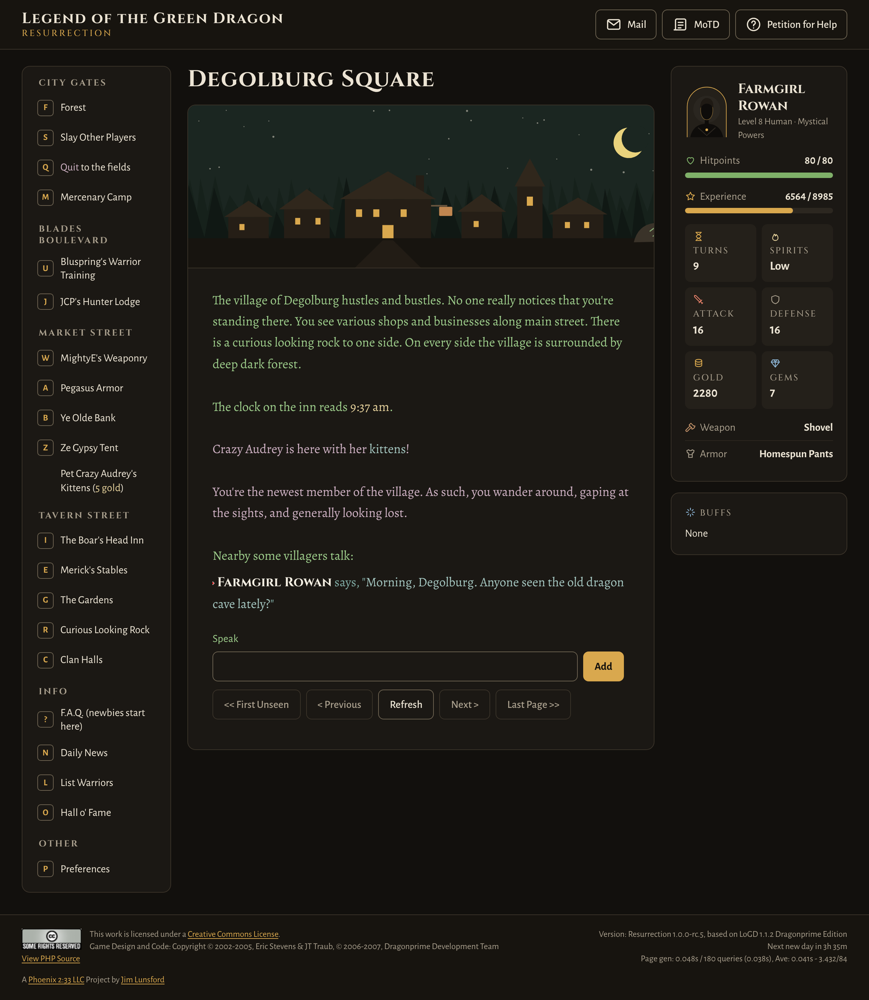
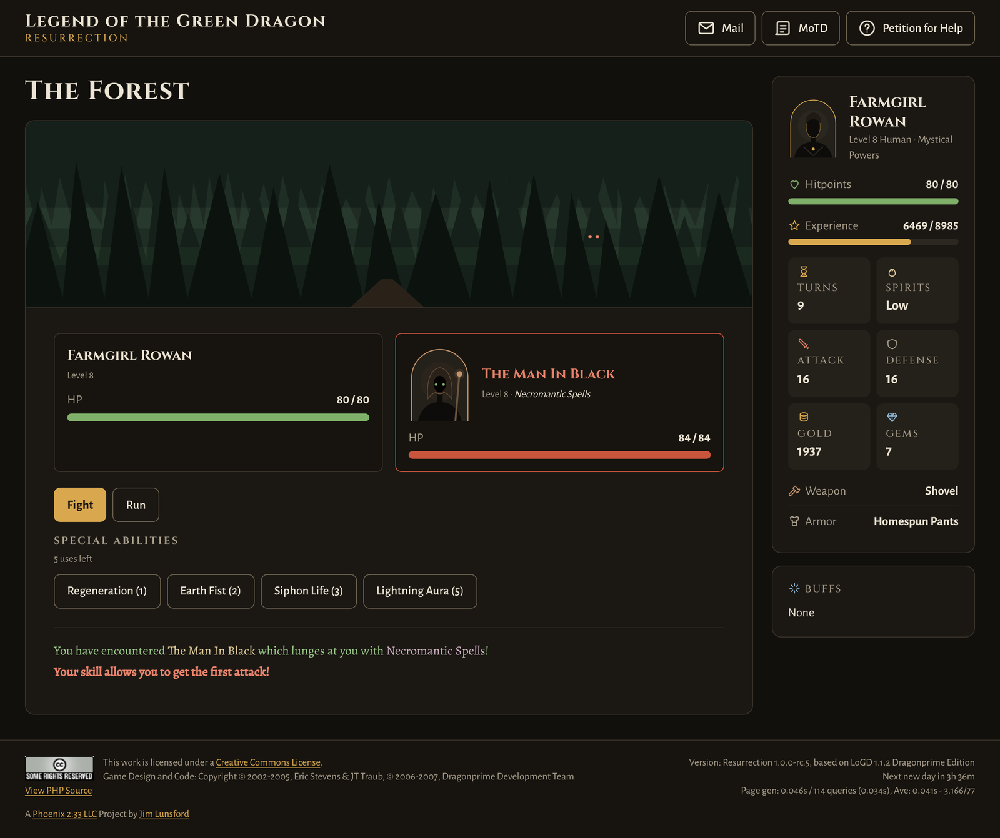
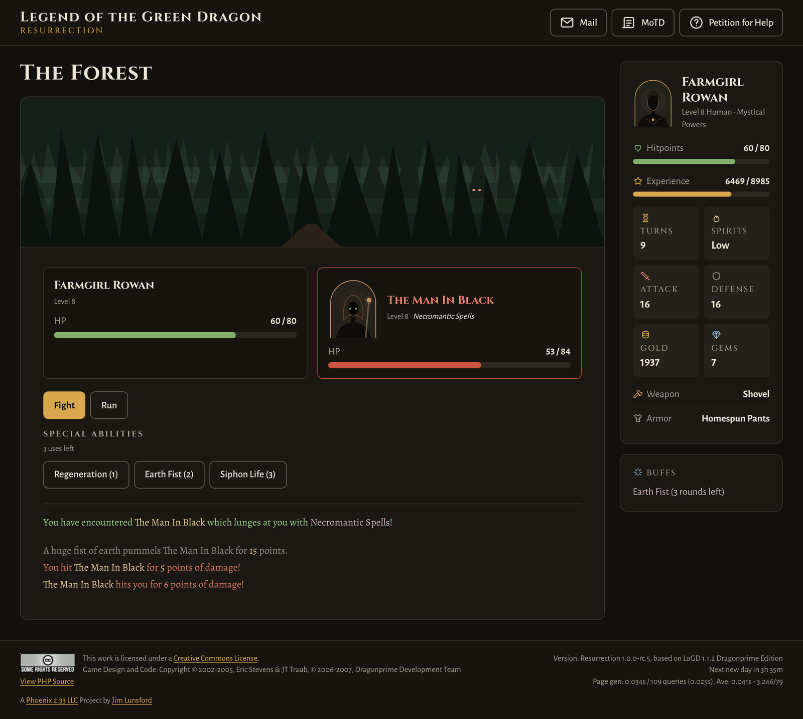
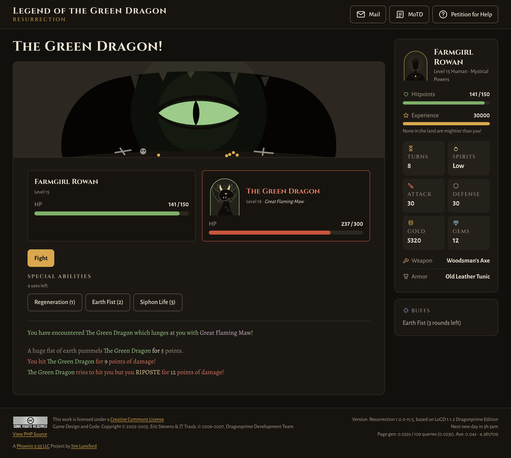
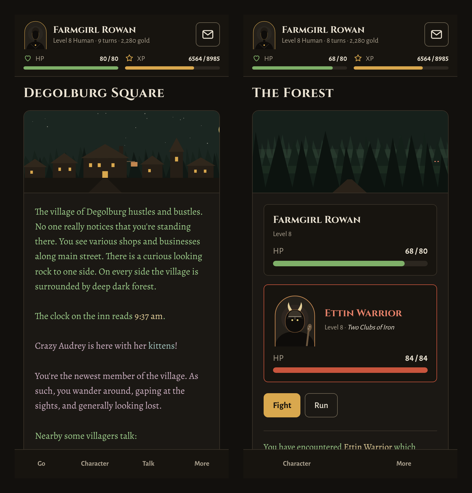

# Legend of the Green Dragon - Resurrection

Resurrection is Legend of the Green Dragon 1.1.2, a browser role-playing game from the mid-2000s, made to run on
today's PHP and databases and fit to host again. It keeps 1.1.2's game, closes its security holes, fixes its defects
and gives it one new interface with original art. Every deliberate change from 1.1.2 is recorded.

Legend of the Green Dragon (LoGD), by Eric Stevens and JT Traub, is in its own words "a browser based role playing
game, based on Seth Able's Legend of the Red Dragon", the BBS door game. Each player keeps a character in a shared
village: they fight creatures in the forest a few turns each game day, train with masters to gain levels, buy weapons
and armor, talk, send mail, join clans, attack other players, and work up to slaying the Green Dragon. Version 1.1.2,
the DragonPrime Edition, was developed further by the DragonPrime Development Team. It was written for PHP 5 and the
old `mysql` extension, which PHP 7 removed.

## Screenshots

| The village square | A forest encounter |
|---|---|
|  |  |
| **A round of battle** | **The Green Dragon** |
|  |  |



## What changed from 1.1.2

Every change that a player, an administrator or a host can notice is in
[docs/CHANGES-FROM-1.1.2.md](docs/CHANGES-FROM-1.1.2.md), with 1.1.2's behavior, the new behavior and why.

**Runtime and security.** The game runs on PHP 8.4 and 8.5 with MariaDB 11.4 or MySQL 8.4, through PDO with every
value bound. Passwords use `password_hash()`. Every change of state is a POST with a CSRF token and is decided on the
server, every route is inventoried, every `eval()` is gone, pages send an enforced Content Security Policy, and the
internal files are refused. 1.1.2's riskiest surfaces are removed: the SQL and PHP console, LoGDnet, the payments, the
source viewer and the old password recovery. Account mail brings password recovery and email verification, and
sign-in is throttled. Evidence: the [security status](docs/SECURITY-STATUS.md), the
[Phase 3 merge gate](docs/PHASE3-MERGE-GATE-20261023.md) and the [route inventory](docs/ROUTE-INVENTORY-20261022.md).

**One dark fantasy interface and original art.** One template replaces 1.1.2's 18 skins: three columns on a desktop,
and one column with a navigation bar on a phone. The art is original SVG drawn for the project: a scene banner for each
place, a portrait for each creature, master and race, and the character panel's icons. Evidence:
[what Phase 5 changed](docs/PHASE5-SUMMARY-20261105.md), the [design spec](docs/UI-DESIGN-SPEC.md) and the
[art's notes](assets/README.md).

**Gameplay fixes.** The rules, creatures and text are 1.1.2's. What changed fixes 1.1.2's defects, or what modern PHP
and strict SQL broke: for example a Green Dragon kill lost under strict SQL when the new title made the name too long,
the forest and the training yard after the game day rolls over, and every page that left a player with no way back.
Evidence: the ledger's [gameplay](docs/CHANGES-FROM-1.1.2.md#gameplay-and-display) and
[Phase 6](docs/CHANGES-FROM-1.1.2.md#phase-6-release-readiness) sections.

**Hosting and upgrades.** The game installs fresh into an empty database, from a shell or, on a host with only a
panel, from the browser (`setup.php`). It upgrades with numbered steps, and CI installs the latest release and
upgrades it on every commit. Daily maintenance runs from a scheduler or from a web address. A release package holds
exactly what to upload. Evidence: the [host guide](docs/HOST-GUIDE.md), [versioning](docs/VERSIONING.md), the
[upgrade system](docs/PHASE4-TASK2-UPGRADE-SYSTEM-20261029.md) and the
[web setup page](docs/PHASE6-TASK5B-SETUP-PAGE-20261106.md).

## How it was built

Jim Lunsford directed the project and decided: what each phase and each task would do, what would change from 1.1.2,
and when a build was good enough. Claude (Anthropic) wrote the code, the documents and the art, in two places: a
planning chat, where Jim worked out each task with Claude, and a separate coding session, where Claude made the change,
ran the checks and published it, following the project's standing rules in [CLAUDE.md](CLAUDE.md).

Nothing counted as done on a local run. Every push runs the full test suite in CI on two legs, PHP 8.4 with MariaDB
11.4 and PHP 8.5 with MySQL 8.4, with a check that the historical source is unchanged; a task was accepted only when
every job passed. Each test build then went to Jim's own test on a real server, and what he found became the next
tasks, until the fifth build passed. The plan, phase by phase and task by task with each acceptance, is in
[ROADMAP.md](ROADMAP.md); each task's evidence is in [docs/](docs/README.md).

## Run it

You need:

- PHP 8.4 or 8.5, with `ctype`, `filter`, `json`, `mbstring`, `pdo`, `pdo_mysql` and `session`
- MariaDB 11.4 or MySQL 8.4: an empty database, and a user allowed only on it
- to host it: HTTPS, and a scheduler for daily maintenance
- to play on your own computer instead: Docker with Compose v2.24 or newer, and Python 3

### Play on your own computer

```sh
python3 scripts/local-play.py up      # start the game; the first time, install it
python3 scripts/local-play.py stop    # stop it; the game is kept
python3 scripts/local-play.py wipe    # delete the game and its data
```

Then open http://127.0.0.1:8080/. This is for play and development only, not for hosting:
[Play locally](docs/MODERN-INSTALLATION.md#play-locally) has the details, upgrades and backups.

### Host it

Download the release package from the
[releases page](https://github.com/jimlunsford/legend-of-the-green-dragon-resurrection/releases), check its SHA-256,
and follow its `INSTALL.txt` and the [host guide](docs/HOST-GUIDE.md), from what you need to backups. A host with a
shell installs with `php scripts/install.php`; a host with only a panel uses `setup.php` in the browser
([host guide, section 5](docs/HOST-GUIDE.md#5-install)).

**Never host the historical source.** The tag `historical-source-1.1.2` keeps 1.1.2 exactly as it was, with known
high-severity security defects and unsupported runtime assumptions. It is kept as a reference. Do not deploy it to a
server the Internet can reach.

## Status

- **Version:** `main` is `1.0.0-rc.5`, the fifth test build, which passed Jim's test on a real server. `1.0.0` is
  next. Known issues: the [release notes for 1.0.0-rc.5](docs/RELEASE-NOTES-1.0.0-rc.5.md).
- **Not certified for public game hosting.** The project's public hosting gates are not all met. Those the code does
  not meet, such as abuse controls beyond sign-in throttling, production TLS, monitoring and an independent review,
  belong to whoever runs a public server ([security status](docs/SECURITY-STATUS.md)).
- **After 1.0.0, bug fixes only**: no new gameplay, art or features ([CONTRIBUTING.md](CONTRIBUTING.md)).

## Documents

- [docs/README.md](docs/README.md): the index of every document, living and record
- [Host guide](docs/HOST-GUIDE.md) and [supported platforms](docs/SUPPORTED-PLATFORMS.md)
- [Changes from 1.1.2](docs/CHANGES-FROM-1.1.2.md) and the [roadmap](ROADMAP.md)
- [Security policy](SECURITY.md) and [contributing](CONTRIBUTING.md)
- [Module author guide](docs/MODULE-AUTHOR-GUIDE.md) and [module policy](docs/MODULE-POLICY.md)

## Historical source and provenance

- The core: the preserved LoGD 1.1.2 DragonPrime Edition source,
  [jimlunsford/lotgd](https://github.com/jimlunsford/lotgd), commit `bdc29df9bc344774b41e0ad7cae7f6ed2f7512e2`, kept
  in this repository under the tag `historical-source-1.1.2`: 417 files, checked on every CI run.
- The module archive: [jimlunsford/lotgd-modules](https://github.com/jimlunsford/lotgd-modules), commit
  `ef92e2df4e27ff29eb596b2b27ce3c9ab2c15187`. Reference only: none of its modules is imported.
- Jim Lunsford uploaded these files to GitHub in 2019 to preserve them. He is not an original LoGD author, and the
  uploads are not the game's development history. [PROVENANCE.md](PROVENANCE.md) has the details.

Resurrection is not the original LoGD project or an official DragonPrime continuation, and is not endorsed by the
original authors or by DragonPrime.

## Licenses and credits

- **The game's code and text:** Creative Commons Attribution-NonCommercial-ShareAlike 2.0, with the LoGD terms in
  [LICENSE.txt](LICENSE.txt), 1.1.2's own license file, unchanged. The project is noncommercial. Resurrection's
  modifications and additions are Copyright (c) 2026 Phoenix 2:33 LLC, under the same terms.
- **The original authors:** Legend of the Green Dragon is by Eric Stevens and JT Traub, continued by the DragonPrime
  Development Team, with the module authors credited in each module. Their copyright notices and credits stay as they
  are, and the game shows them on every page.
- **The art:** original art by Phoenix 2:33 LLC, under Creative Commons Attribution-ShareAlike 4.0
  ([assets/LICENSE](assets/LICENSE)). Credit: "Art by Phoenix 2:33 LLC, CC BY-SA 4.0".
- **Fonts and tools:** the fonts are under the SIL Open Font License 1.1, and the development tools under their own
  licenses ([third-party licenses](docs/THIRD-PARTY-LICENSES.md)).
- **README.txt** is 1.1.2's own readme, unchanged. Its install steps are 1.1.2's and do not apply to Resurrection.

The game credits Resurrection on every page and popup, on its own line under the original authors' credit: "A Phoenix
2:33 LLC Project by Jim Lunsford", with "Phoenix 2:33 LLC" linking to https://phoenix233.com and "Jim Lunsford" to
https://jimlunsford.com. This is the credit section 4(d) of CC BY-NC-SA 2.0 describes: anyone who distributes or
publicly performs the work keeps its copyright notices intact and gives credit, with the URI the licensor names "to the
extent reasonably practicable", and in a derivative work "at a minimum such credit will appear where any other
comparable authorship credit appears and in a manner at least as prominent as such other comparable authorship
credit". [NOTICE](NOTICE) quotes section 4(d) in full, states the license and the credits, and adds no term of its own.

The game's "View PHP Source" link opens the public source; the `sourceurl` setting changes it, for example to a host's
own modified source (`LICENSE.txt` has the terms for a changed game's source).
