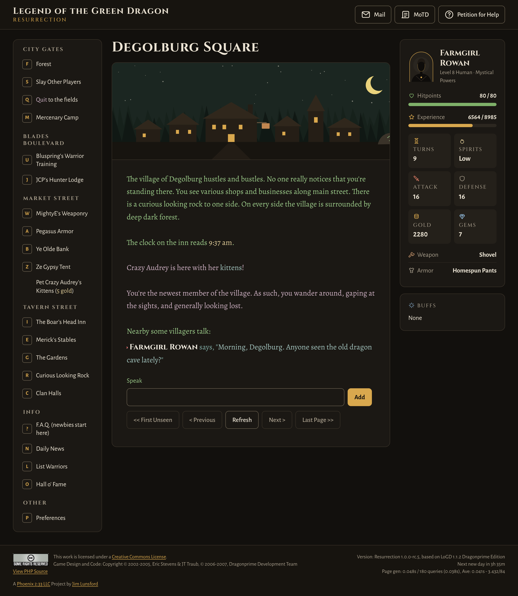

# Release notes: Legend of the Green Dragon - Resurrection 1.0.0

2026-11-21. Cut by `docs/RC-CUT-CHECKLIST.md` on the maintainer's go; the tag is `v1.0.0`. The first release of
Resurrection, after five test builds, `1.0.0-rc.1` to `1.0.0-rc.5`, each tested by Jim on a real server.

## What Resurrection is

Resurrection is Legend of the Green Dragon 1.1.2, a browser role-playing game from the mid-2000s, made to run on
today's PHP and databases and fit to host again. Each player keeps a character in a shared village: they fight in the
forest a few turns each game day, train with masters to gain levels, buy weapons and armor, talk, send mail, join
clans, and work up to slaying the Green Dragon. Resurrection keeps 1.1.2's game, closes its security holes, fixes its
defects and gives it one new interface with original art.

## What it is built on, and what changed from 1.1.2

It is built on LoGD 1.1.2 DragonPrime Edition, by Eric Stevens and JT Traub and the DragonPrime Development Team, kept
unchanged in the repository under the tag `historical-source-1.1.2`. Every change that a player, an administrator or a
host can notice is in the
[changes from 1.1.2](https://github.com/jimlunsford/legend-of-the-green-dragon-resurrection/blob/v1.0.0/docs/CHANGES-FROM-1.1.2.md),
with 1.1.2's behavior, the new behavior and why. In short:

- **Runtime.** PHP 8.4 and 8.5, with MariaDB 11.4 or MySQL 8.4, through PDO with every value bound.
- **Security.** Passwords use `password_hash()`. Every change of state is a POST with a CSRF token and is decided on
  the server. No `eval()`. Pages send an enforced Content Security Policy, and the internal files are refused. 1.1.2's
  riskiest surfaces are removed: the SQL and PHP console, LoGDnet, the payments, the source viewer and the old password
  recovery. Account mail brings password recovery and email verification, and sign-in is throttled. Each control and
  what is left over:
  [security status](https://github.com/jimlunsford/legend-of-the-green-dragon-resurrection/blob/v1.0.0/docs/SECURITY-STATUS.md).
- **Interface and art.** One dark fantasy template replaces 1.1.2's 18 skins: three columns on a desktop, one column
  with a navigation bar on a phone. Original SVG art: a scene for each place, a portrait for each creature, master and
  race, and the character panel's icons.
- **Gameplay.** The rules, creatures and text are 1.1.2's. What changed fixes 1.1.2's defects, or what modern PHP and
  strict SQL broke, and no page leaves a player without a way on.
- **Hosting.** A fresh install from a shell or, on a host with only a panel, from the browser (`setup.php`); upgrades
  in numbered steps; daily maintenance from a scheduler or a web address; and a release package that holds exactly
  what to upload.

## Install

Download `legend-of-the-green-dragon-resurrection-1.0.0.zip` and its `.sha256` from this page, check the SHA-256, and
follow the zip's `INSTALL.txt` and the
[host guide](https://github.com/jimlunsford/legend-of-the-green-dragon-resurrection/blob/v1.0.0/docs/HOST-GUIDE.md).
Only the contents of `upload/` go on the server. Installs are fresh, into an empty database: no 1.1.2 database is
upgraded or migrated.

## Upgrading

From a test build, follow the host guide's section 9, "Upgrade", in short:

1. Back up the database and the configuration file.
2. Upload 1.0.0 into a new folder beside the old one, with the configuration file if it sits in the game's folder,
   then swap the folders.
3. Run `php scripts/upgrade.php --dry-run`, then `php scripts/upgrade.php --backup-confirmed`, or the upgrade on
   `setup.php` with a new token file.
4. Check that the footer shows 1.0.0, then delete the old folder.

- **From rc.5, rc.4, rc.3 or rc.2:** no upgrade step runs. 1.0.0 changes no stored row: the game shows no "Upgrade
  Needed", and the upgrade finds the database current.
- **From rc.1:** two steps run, in order: `0002-signin-limits` and `0003-utf8-seed-text`. Until they are done, the game
  shows "Upgrade Needed".

## What changed since 1.0.0-rc.5

The project's documents (Phase 6 task 31):

- **A new front page.** The README says what Resurrection is and what Legend of the Green Dragon was, with
  screenshots; what changed from 1.1.2 and where each change is recorded; how it was built; how to play it on your own
  computer and how to host it; and the licenses and credits.
- **Every guide brought up to date.** The host guide is for running the game on a web server and the local install
  guide for playing on your own computer, and each points to the other. The supported platforms page gives PHP's and
  the databases' support dates. The documents have an index, `docs/README.md`.

Four small fixes (Phase 6 task 32):

- **A failed escape reads as it should.** When you tried to run from a forest fight and failed, the message showed a
  stray "`` `\$ ``" in front of "You failed to flee your opponent!", in the ordinary text color. It now shows as it
  did in 1.1.2: centered, bold and red.
- **"1 use left".** The battle screen's Special Abilities note said "1 uses left" when one use was left. It now says
  "1 use left", and "2 uses left" and so on for more.
- **The setup page is honest about newer PHP.** The web setup page said "8.4 or 8.5 needed" but marked any PHP from
  8.4 up as fine. PHP 8.4 and 8.5 still show as fine, and an older PHP still fails. A newer PHP now gets a warning,
  "untested; Resurrection supports PHP 8.4 and 8.5", and setup may go on.
- **Recorded, not changed: special abilities need skill as well as uses.** In 1.1.2 an ability could be used whenever
  enough uses were left that day, so a brand-new character (skill 0) could spend its one daily bonus use on its first
  ability. In Resurrection an ability of level 1, 2, 3 or 5 also needs at least that much skill, so a new character
  waits for its first skill point (from training, the Fairy or the Foil Wench). This is now written down as a change
  from 1.1.2, and it stays as it is, so the game's balance does not move at the last step.

And the version: the footer and the home page read "Version: Resurrection 1.0.0, based on LoGD 1.1.2 Dragonprime
Edition", and the pages that link the host guide link it at this release's tag.

## Known issues

- **Mail is best effort, through PHP's `mail()` only.** There is no SMTP setting. A message that cannot be handed over
  is logged and the game goes on (host guide, "Mail"). Until the host turns account mail on, there is no recovery by
  email: an administrator resets a password in the user editor.
- **A link's token reaches the web server's access log.** The game never logs it, but the server records the address
  a player opens for the link's life (30 minutes for recovery, 24 hours otherwise); the host guide says to keep logs
  behind the panel login.
- **1.1.2 behaviors kept as they were** (`ROADMAP.md`, Phase 3, "Recorded, not changed"), among them: a ban reason is
  shown to the banned visitor as raw HTML (staff write it); clearing the `lgi` cookie evades an ID ban; weapon, armor
  and title text allows color codes; the clan-delete hook is not called on disband; the healer resets hitpoints above
  the maximum on view; the Graveyard views sober a dead player; the MoTD archive skips its first month.
- **A 1.1.2 data oddity:** two creatures are both "Loneliness".
- **The Dark Horse Tavern's door takes one press more than 1.1.2's, each way.** Riding in on a mount and leaving the
  tavern each show a page with one button to confirm, because the game changes your state only by a button, never by
  a link; 1.1.2 did both with a link.
- **Refusals on the staff tools and on pages outside the game itself (the sign-in, mail, the MoTD, petitions) stay
  plain on purpose:** a line of text, as before.
- **Modules beyond the bundled 24** are not supported: installed module code is trusted PHP.
- **Maintenance is not one transaction.** A failed run repeats its date-based cleanups on the next run.
- **No 1.1.2 migration**, by design: install fresh.
- **Abuse controls beyond sign-in throttling are the operator's:** no limit on posting floods; account creation is
  limited only while sign-ups must confirm their address (5 an hour from one network address).
- **Images carry no version** in their URLs: a long browser cache of the pictures can outlast an upgrade, so do not
  set far-future caching for `assets/` images.

## Licenses and credits

- **The game's code and text:** Creative Commons Attribution-NonCommercial-ShareAlike 2.0, with the LoGD terms in
  `LICENSE.txt`, 1.1.2's own license file, unchanged. The project is noncommercial. Resurrection's modifications and
  additions are Copyright (c) 2026 Phoenix 2:33 LLC, under the same terms. The original authors' copyright notices and
  credits stay as they are, and the game shows them on every page.
- **The art:** original art by Phoenix 2:33 LLC, under Creative Commons Attribution-ShareAlike 4.0 (`assets/LICENSE`).
- **Fonts and tools:** under their own licenses, the fonts under the SIL Open Font License 1.1
  (`THIRD-PARTY-LICENSES.md`).

The game credits Resurrection on every page and popup, on its own line under the original authors' credit: "A Phoenix
2:33 LLC Project by Jim Lunsford", linking to https://phoenix233.com and https://jimlunsford.com. This is the credit
section 4(d) of CC BY-NC-SA 2.0 describes: in a derivative work "at a minimum such credit will appear where any other
comparable authorship credit appears and in a manner at least as prominent as such other comparable authorship
credit". `NOTICE` quotes section 4(d) in full and adds no term of its own. Licensing was closed by Jim's decision of
2026-11-12, without legal counsel; no file is labeled AGPL.

## Status

- **Not certified for public game hosting.** No independent security review has been done, and the project's public
  hosting gates are not all met; `project.json` keeps `public_game_hosting_approved` at `false`. The gates the code
  does not meet, such as abuse controls beyond sign-in throttling, production TLS, monitoring and an independent
  review, belong to whoever runs a public server (the host guide, at its top).
- **After 1.0.0, bug fixes only:** no new gameplay, art or features. Fixes come as bug-fix releases.
